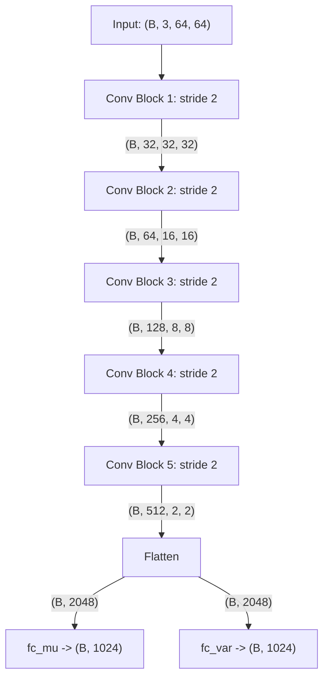
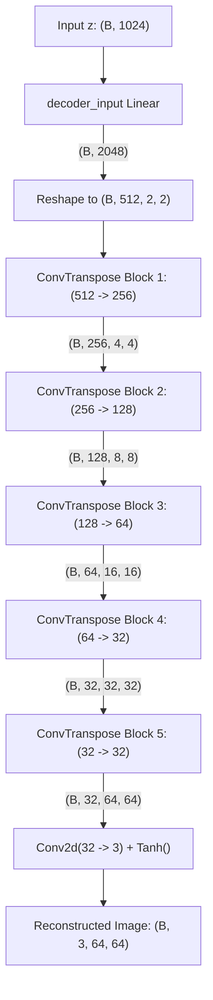

# Tensor Dimension Flow for Conv-VAE

This document traces the tensor dimensions step-by-step through every layer of the **Encoder**, **Reparameterization Trick**, **Decoder**, and full **VAE**.

---

## 1. Global Hyperparameters & Configurations

| Parameter | Value | Description |
| :--- | :--- | :--- |
| `B` | `batch_size` | Number of samples in the batch |
| `C_in` / `C_out` | `3` | Number of image channels (RGB) |
| `H_in` $\times$ `W_in` | `64 x 64` | Target image resolution |
| `hidden_dims` | `[32, 64, 128, 256, 512]` | Number of channels per convolutional layer |
| `latent_dim` | `1024` | Bottleneck latent space dimension ($z$) |

---

## 2. Encoder Layer-by-Layer Dimensions

The encoder downsamples the image using 5 convolutional blocks. Each block consists of:
- `nn.Conv2d(kernel_size=3, stride=2, padding=1)` $\to$ spatial size is halved: $\lfloor \frac{H - 1 + 2}{2} \rfloor + 1 = \lfloor \frac{H + 1}{2} \rfloor$.
- `nn.BatchNorm2d(...)`
- `nn.LeakyReLU()`



### Encoder Step-by-Step Table

| Stage | Operation / Layer | Input Shape | Output Shape | Formula / Notes |
| :--- | :--- | :--- | :--- | :--- |
| **Input** | Batch of Images | — | `(B, 3, 64, 64)` | Normalized to $[-1, 1]$ |
| **Layer 1** | `Conv2d(3, 32, k=3, s=2, p=1)` + BN + LeakyReLU | `(B, 3, 64, 64)` | `(B, 32, 32, 32)` | $64 / 2 = 32$ |
| **Layer 2** | `Conv2d(32, 64, k=3, s=2, p=1)` + BN + LeakyReLU | `(B, 32, 32, 32)` | `(B, 64, 16, 16)` | $32 / 2 = 16$ |
| **Layer 3** | `Conv2d(64, 128, k=3, s=2, p=1)` + BN + LeakyReLU | `(B, 64, 16, 16)` | `(B, 128, 8, 8)` | $16 / 2 = 8$ |
| **Layer 4** | `Conv2d(128, 256, k=3, s=2, p=1)` + BN + LeakyReLU | `(B, 128, 8, 8)` | `(B, 256, 4, 4)` | $8 / 2 = 4$ |
| **Layer 5** | `Conv2d(256, 512, k=3, s=2, p=1)` + BN + LeakyReLU | `(B, 256, 4, 4)` | `(B, 512, 2, 2)` | $4 / 2 = 2$ |
| **Flatten** | `torch.flatten(..., start_dim=1)` | `(B, 512, 2, 2)` | `(B, 2048)` | $512 \times 2 \times 2 = 2048$ |
| **Mean Head** | `fc_mu: Linear(2048, 1024)` | `(B, 2048)` | `(B, 1024)` | $\mu$ (mean) |
| **Variance Head** | `fc_var: Linear(2048, 1024)` | `(B, 2048)` | `(B, 1024)` | $\log \sigma^2$ (log variance) |

---

## 3. Reparameterization Trick Dimensions

The reparameterization trick allows gradients to backpropagate through the stochastic sampling process:

$$\sigma = \exp(0.5 \times \log \sigma^2)$$
$$\epsilon \sim \mathcal{N}(0, I)$$
$$z = \mu + \sigma \odot \epsilon$$

| Step | Operation | Input Shape | Output Shape | Notes |
| :--- | :--- | :--- | :--- | :--- |
| **Standard Deviation** | `std = torch.exp(0.5 * log_var)` | `(B, 1024)` | `(B, 1024)` | Element-wise exponential |
| **Random Noise** | `eps = torch.randn_like(std)` | `(B, 1024)` | `(B, 1024)` | Sampled from standard normal $\mathcal{N}(0, I)$ |
| **Latent Vector** | `z = eps * std + mu` | `(B, 1024)` | `(B, 1024)` | **Latent code $z$ fed into Decoder** |

---

## 4. Decoder Layer-by-Layer Dimensions

The decoder projects the 1024-dimensional latent code back to spatial dimensions ($2 \times 2$), then upsamples 5 times using `ConvTranspose2d` with `kernel_size=3, stride=2, padding=1, output_padding=1`:

$$H_{out} = (H_{in} - 1) \times \text{stride} - 2 \times \text{padding} + \text{kernel\_size} + \text{output\_padding}$$
$$H_{out} = (H_{in} - 1) \times 2 - 2 + 3 + 1 = 2 \times H_{in}$$



### Decoder Step-by-Step Table

| Stage | Operation / Layer | Input Shape | Output Shape | Formula / Notes |
| :--- | :--- | :--- | :--- | :--- |
| **Latent Input** | Sampled latent vector $z$ | — | `(B, 1024)` | From reparameterization or $\mathcal{N}(0, I)$ |
| **Projection** | `decoder_input: Linear(1024, 2048)` | `(B, 1024)` | `(B, 2048)` | $512 \times 2 \times 2 = 2048$ |
| **Reshape** | `result.view(-1, 512, 2, 2)` | `(B, 2048)` | `(B, 512, 2, 2)` | Restores spatial feature map |
| **Deconv 1** | `ConvTranspose2d(512, 256)` + BN + LeakyReLU | `(B, 512, 2, 2)` | `(B, 256, 4, 4)` | $2 \times 2 = 4$ |
| **Deconv 2** | `ConvTranspose2d(256, 128)` + BN + LeakyReLU | `(B, 256, 4, 4)` | `(B, 128, 8, 8)` | $4 \times 2 = 8$ |
| **Deconv 3** | `ConvTranspose2d(128, 64)` + BN + LeakyReLU | `(B, 128, 8, 8)` | `(B, 64, 16, 16)` | $8 \times 2 = 16$ |
| **Deconv 4** | `ConvTranspose2d(64, 32)` + BN + LeakyReLU | `(B, 64, 16, 16)` | `(B, 32, 32, 32)` | $16 \times 2 = 32$ |
| **Deconv 5** | `ConvTranspose2d(32, 32)` + BN + LeakyReLU | `(B, 32, 32, 32)` | `(B, 32, 64, 64)` | $32 \times 2 = 64$ |
| **Final Conv** | `Conv2d(32, 3, k=3, p=1)` | `(B, 32, 64, 64)` | `(B, 3, 64, 64)` | Projects channels to RGB |
| **Activation** | `nn.Tanh()` | `(B, 3, 64, 64)` | `(B, 3, 64, 64)` | Bounded in range $[-1, 1]$ |

---

## 5. Summary of Overall VAE Forward & Loss

```
Input x: (B, 3, 64, 64)
  │
  ├─► Encoder(x) ───────────────► mu: (B, 1024), log_var: (B, 1024)
  │                                    │
  │                               reparameterize(mu, log_var)
  │                                    │
  │                                    ▼
  │                               z: (B, 1024)
  │                                    │
  │                               Decoder(z)
  │                                    │
  │                                    ▼
  └─► Reconstruction Loss ◄────── recons: (B, 3, 64, 64)
           │
           ├─► MSE(recons, x)                                 (scalar)
           └─► KLD(mu, log_var) = -0.5 * sum(1 + log_var - mu² - exp(log_var)) (scalar)
```

### Generation (Inference) Mode
During sampling / generation, the encoder is bypassed entirely:
```
Prior Noise: z ~ N(0, I) with shape (N_samples, 1024)
  │
  └─► Decoder(z) ──► Generated Images with shape (N_samples, 3, 64, 64)
```
